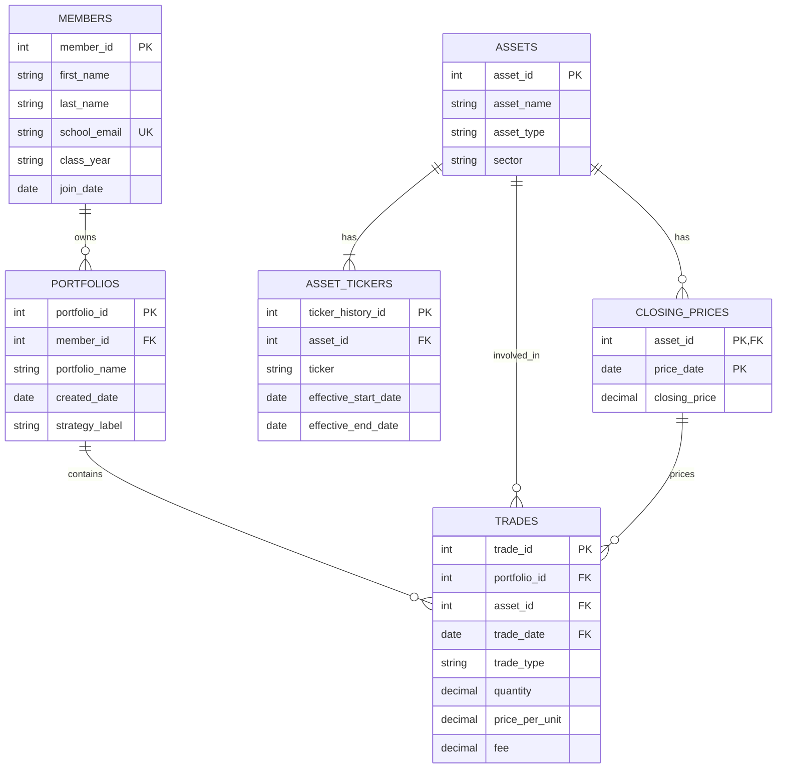

# The Scenario

I chose the Babson Investment Club database scenario.

The Babson Investment Club manages paper investment portfolios for its members to help them learn about investing. The database will replace the club's current system of spreadsheets and broker screenshots with a centralized system that tracks members, portfolios, assets, trades, and historical closing prices.

The database will use 2022 as its year of historical data so that it can capture the Facebook ticker change from FB to META. It will include approximately 15 members, at least 12 assets, at least 300 trades, and historical closing prices for every weekday for stocks and ETFs and every day for cryptocurrency.

The goal is to maintain a complete history of investment activity, calculate portfolio holdings, and determine portfolio values over time.

# The ERD

# What One Row Means

- **Members:** One row represents one Babson Investment Club member, including their personal information and membership details.
- **Portfolios:** One row represents one investment portfolio owned by one member.
- **Assets:** One row represents one unique investment asset, such as a stock, ETF, or cryptocurrency.
- **Asset_Tickers:** One row represents a ticker symbol associated with an asset during a specific period of time.
- **Trades:** One row represents one purchase or sale of an asset within a portfolio on a specific date.
- **Closing_Prices:** One row represents the closing price of one asset on one specific date.

# Design Choices